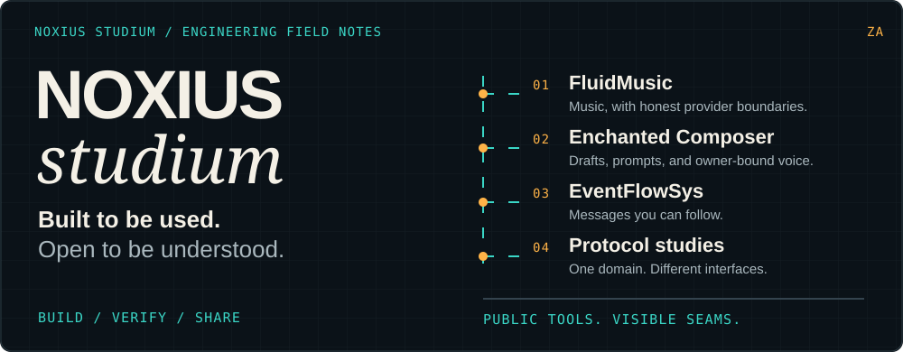
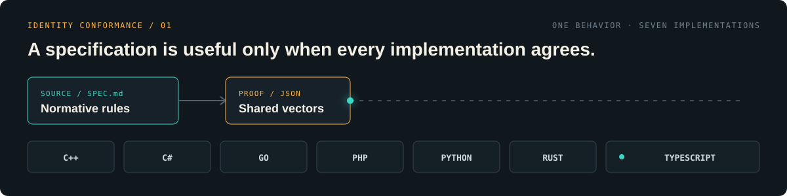
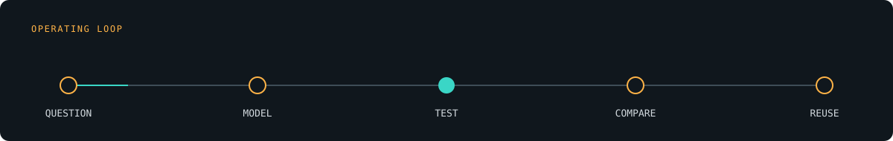

<p align="center">
  
</p>

<p align="center">
  <strong>A learning-first engineering lab for the parts worth understanding.</strong><br />
  <sub>Tools, specifications, and reference implementations — with the seams left visible.</sub>
</p>

<p align="center">
  <a href="https://github.com/noxius-studium?tab=repositories"></a>
  <a href="https://pypi.org/project/eventflowsys/"></a>
  
</p>

---

## The workbench

We return to the same engineering question from different directions: **how do you make behavior visible, comparable, and reusable?**

### 01 / Identity conformance

<p align="center">
  
</p>

One normative South African ID-number specification, one shared conformance suite, and implementations in **C++, C#, Go, PHP, Python, Rust, and TypeScript**. The repository remains on the private workbench while the implementations converge — no public 404 links pretending otherwise.

### 02 / Event systems · [`eventflowsys`](https://github.com/noxius-studium/eventflowsys)

<p align="center">
  <a href="https://github.com/noxius-studium/eventflowsys"></a>
</p>

A Python event bus with threaded and `asyncio` implementations, grouped subscriptions, priority, TTL, broadcast delivery, hooks, unread tracking, and metrics.

```bash
pip install eventflowsys
```

[`README`](https://github.com/noxius-studium/eventflowsys#readme) · [`tests`](https://github.com/noxius-studium/eventflowsys/tree/main/tests) · [`PyPI`](https://pypi.org/project/eventflowsys/)

### 03 / Protocol parity · [`soap-json-graphql-example`](https://github.com/noxius-studium/soap-json-graphql-example)

<p align="center">
  <a href="https://github.com/noxius-studium/soap-json-graphql-example"></a>
</p>

The same user operations exposed through **REST**, **GraphQL**, and **SOAP**. The domain stays fixed so the protocol trade-offs become obvious in real calling code.

[`README`](https://github.com/noxius-studium/soap-json-graphql-example#readme) · [`application entry point`](https://github.com/noxius-studium/soap-json-graphql-example/blob/main/main.py)

### 04 / Private workshop

<p align="center">
  
</p>

Behind the public repositories: the **Noxius** Tauri desktop launcher, **Hermes** composer and media plugins, a curated skill library, and defensive software-protection research. These stay private until their boundaries, documentation, and release story are strong enough to stand on their own.

---

## How we work

<p align="center">
  
</p>

- **Specifications before slogans.** Shared behavior is written down and tested.
- **Examples that run.** Repositories teach through executable code, not screenshots alone.
- **Different tools, same question.** Languages and protocols are compared on equivalent problems.
- **Honest boundaries.** Experiments are labelled as experiments; production claims require evidence.

## Contributing

Public repositories are open for focused issues and pull requests. Start with the repository README and tests, keep changes narrow, and include a runnable example when behavior changes.

---

<p align="center">
  <sub>Build it. Break the assumption. Write down what survived.</sub>
</p>
