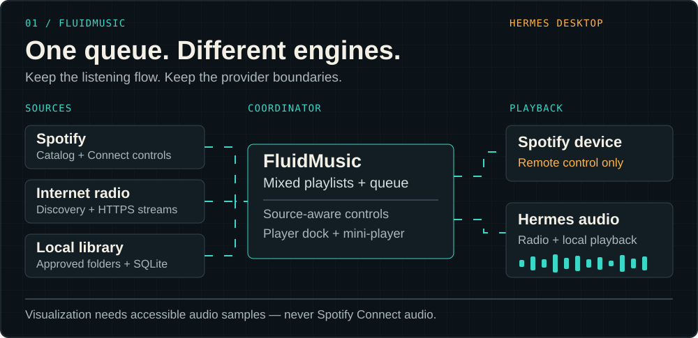
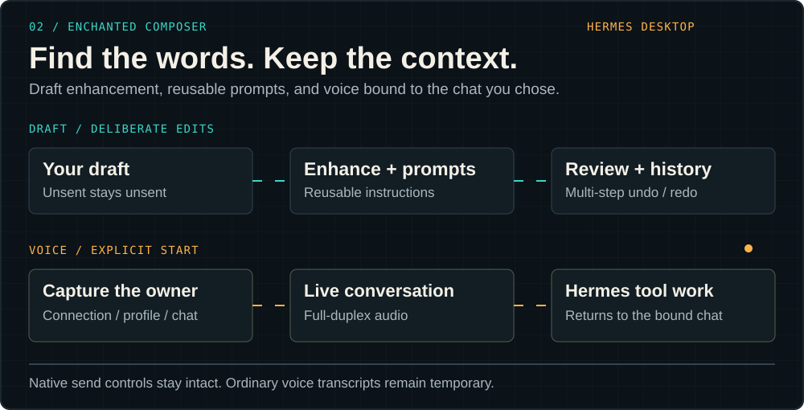

<p align="center">
  
</p>

<p align="center">
  <strong>A learning-first engineering lab, building tools you can use and systems you can inspect.</strong><br />
  Desktop music, better composition, observable events, and executable protocol comparisons.
</p>

<p align="center">
  <a href="https://github.com/noxius-studium?tab=repositories">Explore the repositories</a> ·
  <a href="https://github.com/noxius-studium/fluid-music">FluidMusic</a> ·
  <a href="https://github.com/noxius-studium/enchanted-composer">Enchanted Composer</a>
</p>

---

## From the workbench to your desktop

**FluidMusic** and **Enchanted Composer** now have their own public repositories. Both extend **Hermes Desktop**, with source, architecture notes, installation guidance, and explicit limitations.

The organization spans **18 repositories: 6 public and 12 private** at this refresh. The public directory below distinguishes the desktop tools, reference projects, and experimental scaffold—not every repository has the same maturity or license.

### 01 / FluidMusic

<a href="https://github.com/noxius-studium/fluid-music"></a>

A music workspace with **Spotify Connect, internet radio, a persistent local library, and mixed playlists**. A player dock and movable mini-player keep playback controls close; the queue coordinates source handoffs without pretending every provider has the same capabilities.

- **Build a collection:** approved-folder indexing, stable local-track references, playlist editing, and JSON import/export.
- **Keep control:** Spotify search and device selection, radio discovery, source-aware transport, and queue management.
- **See the sound where available:** spectrum, waveform, and mirrored visuals for accessible audio samples. Spotify Connect and indexed local playback are not analysed. Browser-opened local files support session-only analysis; radio analysis depends on station CORS.

[`Source & setup`](https://github.com/noxius-studium/fluid-music#readme) · [`Releases`](https://github.com/noxius-studium/fluid-music/releases) · [`Architecture`](https://github.com/noxius-studium/fluid-music/blob/main/docs/architecture.md) · [`Limitations`](https://github.com/noxius-studium/fluid-music/blob/main/docs/limitations.md)

### 02 / Enchanted Composer

<a href="https://github.com/noxius-studium/enchanted-composer"></a>

**Draft enhancement, reusable prompt libraries, multi-step undo/redo, and owner-bound live voice**—without replacing Hermes's native send, model, dictation, or voice controls.

- **Refine before sending:** enhance an unsent draft, reuse prompts, and step through revision history without repeating the model call for redo.
- **Keep voice in context:** explicitly started full-duplex voice captures its connection, profile, and chat; delegated tool work stays with that owner.
- **Make the boundaries visible:** credentials stay backend-side, microphone access is explicit, and provider/billing routes do not silently switch. Ordinary voice transcripts remain temporary; delegated tool requests and results are retained in the bound chat.

[`Source`](https://github.com/noxius-studium/enchanted-composer) · [`Installation`](https://github.com/noxius-studium/enchanted-composer/blob/main/docs/installation.md) · [`Architecture`](https://github.com/noxius-studium/enchanted-composer/blob/main/docs/architecture.md) · [`Privacy & security`](https://github.com/noxius-studium/enchanted-composer/blob/main/docs/privacy-and-security.md) · [`Limitations`](https://github.com/noxius-studium/enchanted-composer/blob/main/docs/limitations.md)

## Reference projects

### Event systems / EventFlowSys

<a href="https://github.com/noxius-studium/eventflowsys"></a>

A Python event bus with threaded and `asyncio` implementations, grouped subscriptions, priority, TTL, broadcast delivery, hooks, unread tracking, and metrics.

```sh
pip install eventflowsys
```

[`Source & examples`](https://github.com/noxius-studium/eventflowsys#readme) · [`Tests`](https://github.com/noxius-studium/eventflowsys/tree/main/tests) · [`PyPI`](https://pypi.org/project/eventflowsys/)

### Protocol comparison / REST · GraphQL · SOAP

<a href="https://github.com/noxius-studium/soap-json-graphql-example"></a>

A shared user domain exposed through **REST, GraphQL, and SOAP**, with concrete calling examples. Compare request shapes and interface choices without changing the underlying domain. This is an educational comparison, not a claim of identical operation coverage across all three interfaces.

[`Source & calling examples`](https://github.com/noxius-studium/soap-json-graphql-example#readme) · [`Application entry point`](https://github.com/noxius-studium/soap-json-graphql-example/blob/main/main.py)

## Public directory

| Repository | What you will find |
| :--- | :--- |
| [fluid-music](https://github.com/noxius-studium/fluid-music) | Hermes Desktop music workspace. **CC BY-NC 4.0**; non-commercial terms apply. |
| [enchanted-composer](https://github.com/noxius-studium/enchanted-composer) | Hermes Desktop draft, prompt, history, and voice tools. **MIT**. |
| [eventflowsys](https://github.com/noxius-studium/eventflowsys) | Python event bus, examples, and tests. **MIT**. |
| [soap-json-graphql-example](https://github.com/noxius-studium/soap-json-graphql-example) | Educational API comparison over a shared user domain. |
| [BaseProjects](https://github.com/noxius-studium/BaseProjects) | Experimental Python database-service scaffold; not a finished product. |
| [.github](https://github.com/noxius-studium/.github) | This organization profile and its original SVG artwork. |

Check each repository's license and documentation before reuse. Visibility is not a blanket license grant.

## Still on the private workbench


The private workshop includes the **Noxius** desktop launcher, **South African ID-number conformance** work across C++, C#, Go, PHP, Python, Rust, and TypeScript, a curated **Hermes skill library**, and **defensive software-protection research**. These are not public downloads or promised release dates. FluidMusic and Enchanted Composer have moved into dedicated public repositories.

## How we work


- **Specifications before slogans.** Write down shared behavior and test it.
- **Examples that run.** Teach through executable code, not screenshots alone.
- **Respect the boundaries.** Provider capabilities, ownership, privacy, and licensing remain explicit.
- **Evidence before claims.** Label experiments; distinguish simulated checks from live acceptance.

## Contributing

Start with the relevant repository's README, contribution guidance, and tests. Focused issues and pull requests are welcome: include a reproducible example, keep changes narrow, and never attach credentials or unredacted private data.

---

<p align="center"><sub>Build it. Break the assumption. Write down what survived.</sub></p>
